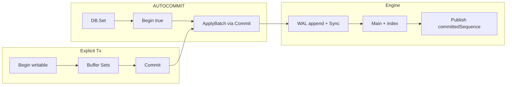

# ACID + Transaction contract + verification

## Contract (what we promise now)

DorraDB provides **ACID transactions**. Every read/write runs inside a transaction:

- **AUTOCOMMIT** — `DB.Get` / `Set` / `Delete` / `Has` = one-shot `Begin` + op + `Commit`/`Rollback`
- **Explicit** — `Begin` / `Commit` / `Rollback` with normal ops on `Tx`

| Property | Meaning |
| --- | --- |
| **A**tomicity | One successful `Set`/`Delete` (or one `Commit` of N buffered ops) is all-or-nothing. Error before durable commit ⇒ no visible/recoverable effect from that tx. Group commit may batch independent AUTOCOMMIT ops; that is not multi-key atomicity across separate `DB.Set`s. |
| **C**onsistency | Engine invariants: exclusive lock, monotonic `sequence`, CRC-valid frames, torn tail ignored, mid-file CRC → `ErrCorrupt`, index rebuildable from main+WAL. App-level invariants are the caller’s job (KV has no schema). |
| **I**solation | Snapshot at `Begin` (`Pin` + `GetVisible`). AUTOCOMMIT reads are statement snapshots. One writable tx at a time (`writeMu`). Concurrent read txs OK. No dirty reads; RYW inside a writable tx. |
| **D**urability | Default (`DisableSync: false`): successful commit return ⇒ fsynced WAL; survives crash via reopen. `DisableSync: true` opts out of **D**. |



## Gap to fix before claiming A/D under faults

**Status:** Split-ack is fixed. Path: WAL append all → Sync → main+index → publish → ack. Mid-group `main.Append` failure: same error to waiters, no publish, synced WAL left for recover.

**Still open:** If the process **keeps running** after that error, earlier ops in the failed group may already be on main+index while `committedSequence` lags. Finish by **fatal-closing the engine** or **rolling forward** the rest of the synced group — no soft continue after post-sync main failure.

## Test architecture (`tests/` is a product surface)

No production-package `*_test.go` for suite logic (including no root `tx_test.go`). Almost all verification lives under [`tests/`](tests/).

```text
tests/
  README.md              # how to run, suite map → guarantees each suite owns
  harness/               # FaultFS, temp DB, corrupt, oracle, reopen
  unit/                  # encode, index
  acid/                  # AUTOCOMMIT single-op A/C/I/D
  tx/                    # explicit Begin/Commit/Rollback + multi-key A/I
  recovery/              # WAL/main crash tails, replay
  checkpoint/            # compact, pins defer (incl. long Tx pins)
  api/                   # public contract, options, lock, Stats
  corrupt/               # format rejection, mid-CRC vs torn
  oracle/                # randomized model (+ Tx-aware ops)
  fuzz/                  # encode (+ optional engine)
  stress/                # concurrent read txs + writer, -race
  cli/                   # thin exec smoke
```

**Rules**

- Harness owns fault injection / temp DBs / oracle; suites stay scenario-focused.
- `engine.OpenWithFS` (+ public wrapper or harness-only path) for deep suites; default `Open` stays `vfs.OS()`.
- Deep suites may import `internal/...`. `api` / `cli` / most of `tx` stick to public `dorradb` API.
- Gate: `go test ./tests/... -race`.

## Test matrix — AUTOCOMMIT (tests/acid + recovery + …)

Same single-op matrix as before, interpreted through the Tx path (`DB.Set` → `Begin(true)` → `Commit` → `ApplyBatch`):

### Atomicity

- Successful `Set` then `Get` sees full value.
- Failed validation leaves DB unchanged.
- Post WAL-sync main fault: recoverable on reopen or none visible before ack (after harden).
- `Delete` missing key succeeds; no invented data.

### Consistency / Isolation / Durability

- Encode/index unit tests; statement snapshot via AUTOCOMMIT `Get`; pins defer compact.
- Default sync crash/reopen; WAL-only recovery; `DisableSync` documented as non-durable.
- Concurrent readers + one writer; `-race` clean.

## Test matrix — Transactions (tests/tx)

Primary home for multi-key and long-lived snapshot behavior. Public API only unless a case needs engine hooks.

### Snapshot isolation

- `Begin(false)` → concurrent `DB.Set` → tx `Get` still sees old value; after `Rollback`, `DB.Get` sees new.
- Repeatable read inside one tx across multiple `Get`s while writers commit.
- Pin held for tx lifetime: compact deferred (`Stats` / checkpoint suite cross-check).

### Read-your-writes + rollback

- Writable tx `Set`/`Delete` then `Get`/`Has` sees buffer (including delete → not found).
- `Rollback` discards buffer; DB unchanged.
- `Rollback` after `Commit` is no-op; data stays committed.

### Multi-key atomicity

- Writable `Begin` + two `Set`s + `Commit` → both visible.
- Same setup + `Rollback` → neither key applied.
- Empty commit (writable Begin, no writes) succeeds; pin released.

### Write serialization

- Open writable tx blocks concurrent `DB.Set` / second `Begin(true)` until Commit/Rollback (mutex wait).
- After release, later writer wins on same key (ordered, no bypass of `writeMu`).
- Concurrent read-only `Begin(false)` OK while a writable tx is open.

### AUTOCOMMIT sugar

- `DB.Set`/`Get`/`Has`/`Delete` match one-op `Begin` + op + `Commit`/`Rollback`.

### Errors

- `Set`/`Delete` on read-only tx → `ErrTxNotWritable`.
- Ops after `Commit`/`Rollback` → `ErrTxClosed`.
- `Commit` after `Rollback` → `ErrTxClosed`.
- Use after `DB.Close` → `ErrClosed` (Begin/Pin failure path).

### Durability of Commit

- With sync on: multi-key `Commit` → reopen → both keys present.
- Crash-style truncate after successful Commit (reuse recovery helpers).
- Uncommitted buffer never appears after reopen (crash mid-tx before Commit).

## Additional reliability (unchanged intent)

API edges, group-commit options, lock lifecycle, corruption/format, checkpoint crash via FaultFS, recovery/replay, oracle (+ extend oracle with random multi-key `Begin`/`Commit` batches), fuzz, Stats (`PinnedReaders` under open Tx), stress, light CLI — as in prior plan.

**Oracle extension:** mix AUTOCOMMIT ops with occasional multi-key txs; model applies batch atomically or not at all.

**Stress extension:** many concurrent read txs + one writable-tx storm; no deadlock on `Close` (Close waits for pins — tests must Rollback/Commit).

## Out of scope (explicit non-guarantees)

- Nested transactions / savepoints
- Optimistic `ErrTxConflict` / SSI write-skew beyond single writer
- Iterators / range phantoms
- Multi-process readers
- Claiming durability when `DisableSync` is set
- Online backup / verify CLI (corruption-on-open covered elsewhere)
- Format migrations beyond “refuse newer version”

## Delivery order

1. ACID + Tx contract in root docs (already partly done) + scaffold `tests/` (README suite map).
2. Harden post-sync `ApplyBatch` / apply failure (fatal close or roll-forward).
3. `OpenWithFS` + `tests/harness`.
4. `tests/unit` → `tests/acid` → `tests/tx` → `tests/recovery` → `tests/checkpoint`.
5. `tests/api` + `tests/corrupt`.
6. `tests/oracle` (Tx-aware) + `tests/fuzz` + `tests/stress` + light `tests/cli`.
7. Gate: `go test ./tests/... -race`; check off README Reliability.
